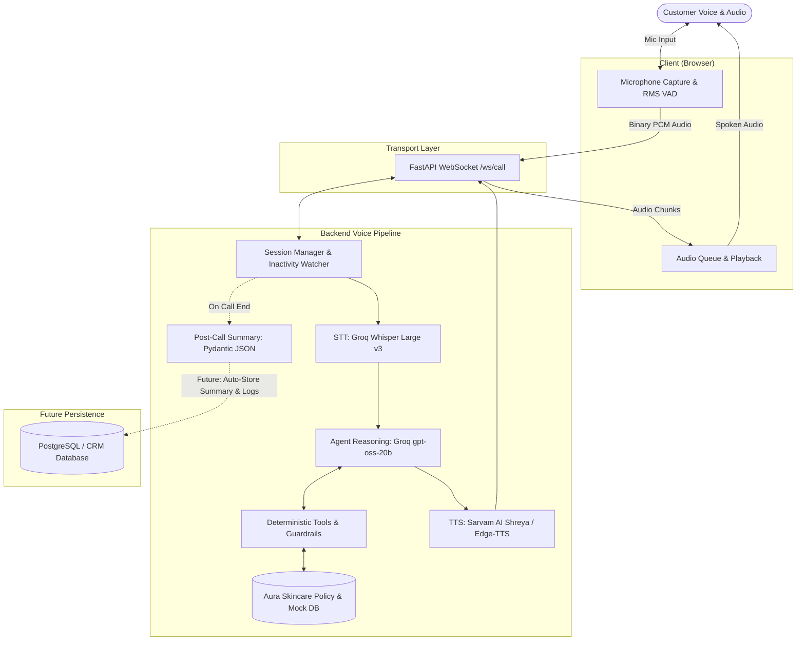

# Aura Skincare — AI Voice Support Agent (Aria)

A real-time, browser-based voice customer support agent built for **Aura Skincare**. You can open the web app, click **Start Call**, speak naturally, and get instant spoken replies with strict brand policy enforcement.

---

## Architecture Overview



### The Core Principle: "Never Trust the LLM"
* **The LLM handles the conversation:** Tone, politeness, empathy, and natural Indian English phrasing (*"Sir"*, *"Ma'am"*).
* **Deterministic Python code handles the rules:** The LLM is never allowed to calculate refund amounts, return windows, or decide if someone is allowed to see an order. All business logic and security checks live in regular Python code.

---

## Key Guardrails

1. **IDOR & Caller Privacy Protection:**
   The backend verifies order ownership in Python before giving data to the LLM. If Priya Sharma asks for Rahul Verma's order (`ORD-102`), the tool rejects it directly. The LLM never sees another customer's data.
2. **2-Step Confirmation for Cancellations:**
   Destructive actions cannot happen on an LLM's whim. Step 1 checks if the order is still `Processing` and flags a pending confirmation. Only after a second explicit verbal confirmation from the user does the tool cancel the order.
3. **Hard-Coded Business Policies:**
   - **Returns:** Strictly within 7 days of delivery and unopened.
   - **Shipping:** Free strictly above ₹499 (₹499 pays ₹50 shipping).
   - **Cash on Delivery (COD):** Allowed only up to ₹2,500.
   - The LLM does not calculate dates or math; Python code evaluates the rules and provides the answer.
4. **Out-of-Scope Deflection:**
   Non-brand requests (like booking flights or general trivia) are politely deflected back to Aura Skincare.

---

## Voice Experience Features

* **Real-Time Barge-In (Interruption):** If the customer speaks while Aria is speaking, playback cuts off instantly and the server stops the current turn.
* **10-Second Silence Detection:** After Aria finishes speaking, a 10-second timer starts. If the user is silent, Aria asks if they are still there (*"Take your time, Ma'am!"*). After another 10 seconds of silence, she gracefully ends the call.
* **Natural Indian Voice:** Uses Sarvam AI (`bulbul:v3`, voice *Shreya*) with automatic fallback to Edge-TTS (`en-IN-NeerjaNeural`).
* **Post-Call Structured Summary:** When the call ends, the backend generates an enum-validated JSON summary (`customer_intent`, `order_id`, `resolution_status`, `call_summary`) validated by Pydantic — ready to be stored directly into a PostgreSQL database or CRM.

---

## Quickstart & Local Setup

### 1. Install Dependencies
```bash
pip install -r requirements.txt
```

### 2. Configure Environment
Copy `.env.example` to `.env` and add your API keys:
```env
GROQ_API_KEY=your_groq_api_key
SARVAM_API_KEY=your_sarvam_api_key
GROQ_MODEL=openai/gpt-oss-20b
PORT=8000
```
*(Note: If `SARVAM_API_KEY` is not provided, it automatically falls back to Edge-TTS.)*

### 3. Run the Application
```bash
uvicorn app.main:app --reload --port 8000
```
Open **http://localhost:8000** in your browser and click **Start Call**.

---

## Testing & Evaluation

* **Unit Tests (14 tests, offline, <1.5s):**
  ```bash
  pytest tests/ -v
  ```
* **Automated Scenarios Evaluation (14 test cases):**
  ```bash
  python scripts/run_scenarios.py
  ```
  Results are saved to `docs/eval_results.md`.

---

## Section 9: Evaluation Questions & Answers

### 1. Why did you choose this architecture and tech stack?
I needed conversational speed without sacrificing business rules. A full-duplex WebSocket lets me stream audio continuously instead of waiting for full recording uploads. Groq gave sub-second inference speeds for Whisper and LLM generation on free-tier, and sentence-level TTS streaming produces audio while the model is still generating. Most importantly, I separated the probabilistic LLM from deterministic Python tools so customer data and policies can never be manipulated.

### 2. What was the most difficult part and how did you solve it?
The hardest engineering challenge was real-time barge-in without telephony hardware. When a customer interrupts mid-sentence, three things must happen simultaneously: the browser audio buffer must dump instantly, the server must cancel its running async LLM and TTS tasks, and the conversation history must be pruned so the model only remembers words the customer actually heard. I solved this by tracking audio packet IDs and implementing a clean cancellation signal over the WebSocket.

### 3. If you had one more week, what would you improve first and why?
First, I'd upgrade the transport from raw WebSockets to WebRTC (like LiveKit). WebRTC handles jitter, packet loss, and echo cancellation natively, making voice much smoother on mobile networks. Second, I'd add a RAG knowledge base for ingredient recommendations so Aria could answer specific routine questions (like layering Vitamin C with Retinol) while keeping return and cancellation rules strictly deterministic.

### 4. What would need to change if the agent handled 1,000 conversations a day?
I'd move session data to Redis, use PostgreSQL for order management with row-level locks on cancellations, and add fallback LLM providers if Groq hits rate limits. I'd cache common responses to reduce TTS latency, add monitoring to track errors and response times, require caller authentication (like SMS OTP) before sharing order details, and mask personal information in transcripts to improve privacy and comply with applicable data protection requirements.
