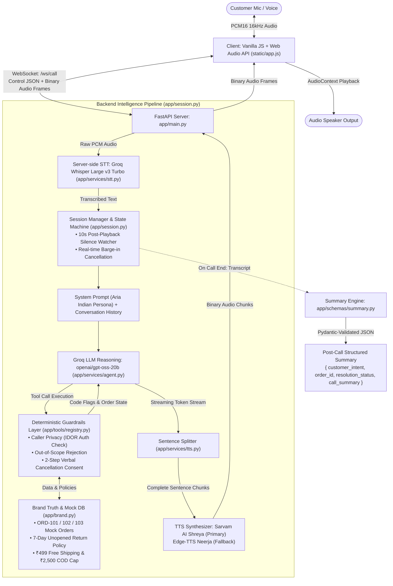

# Aura Skincare - AI Voice Support Agent (Aria)

A real-time, browser-based voice customer support agent built for the fictional brand **Aura Skincare**. Evaluators can open the web application, click **Start Call**, speak naturally, and hear conversational spoken replies with authoritative brand policy enforcement.

---

## Architecture Overview



---

## Architecture Philosophy: Guardrails for Secure AI ("Never Trust the LLM")

A foundational architectural decision in this system is: **Never trust the LLM with business logic, authorization, or security enforcement.**

### 1. Why AI Security is Harder than Traditional Software
* In a deterministic web app, a client calls an API endpoint, and the server runs fixed validation code (`if user_id != order.user_id: raise Forbidden()`). Persuasive language cannot rewrite an `if` condition.
* In an LLM application, behavior is governed by **Code + Model**. The model is probabilistic and can be influenced by natural language speech. Even if a system prompt instructs the model to enforce a policy, an attacker can use prompt injection or social engineering to bypass prompt instructions.
* **Risk multiplies with tool capabilities.** An LLM without tools merely produces text; an LLM with tools can cancel orders, trigger fraudulent refunds, or leak other users' confidential data.

### 2. The Architectural Principle: The LLM is Guidance, Deterministic Code is Enforcement
We treat the LLM like a **highly capable, persuasive junior customer care specialist**:
* **Guidance (LLM):** Tone, conversational flow, natural Indian English phrasing (*"Sir"*, *"Ma'am"*), empathy, and intent detection.
* **Enforcement (Deterministic Python Code):** Authentication, IDOR ownership checks, 2-step consent tracking, refund limits, and return window calculations.

### 3. The 4-Layer Guardrail Defense Implemented in this Project

```
[Customer Voice Input]
          │
          ▼
┌────────────────────────────────────────────────────────┐
│ 1. INPUT GUARDRAILS                                    │
│ • Client-side RMS VAD (Filters background room noise) │
│ • STT Hallucination Screening (Discards phantom noise) │
│ • Prompt Injection Delimiters (<customer_utterance>)   │
└──────────────────────────┬─────────────────────────────┘
                           │
                           ▼
┌────────────────────────────────────────────────────────┐
│ 2. SYSTEM & PROMPT GUARDRAILS                          │
│ • Aria Voice Persona (Friendly, concise Indian voice)  │
│ • Untrusted Data Directives (Never obey overrides)     │
│ • Out-of-Scope Blocker (Rejects non-Aura requests)     │
└──────────────────────────┬─────────────────────────────┘
                           │
                           ▼
┌────────────────────────────────────────────────────────┐
│ 3. DETERMINISTIC TOOL GUARDRAILS (Strict Python Code)  │
│ • IDOR Caller Check (Matches order owner vs caller)    │
│ • 2-Step Consent Engine (Requires double confirmation) │
│ • Python Policy Math (₹499 shipping, 7-day returns)   │
└──────────────────────────┬─────────────────────────────┘
                           │
                           ▼
┌────────────────────────────────────────────────────────┐
│ 4. OUTPUT GUARDRAILS                                   │
│ • Sentence-Level Punctuation Streamer                  │
│ • Zero Markdown/Symbols Filter for Audio               │
│ • Pydantic Schema Validation for Structured Summary   │
└────────────────────────────────────────────────────────┘
```

1. **Input Guardrails:**
   - Client-side RMS Voice Activity Detection (`threshold: 0.010`, `0.016` during playback) stops room hum and keyboard clicks before transmission.
   - Whisper hallucination filtering in `app/services/stt.py` (`no_speech_prob > 0.45` and noise word disallowlist) prevents phantom inputs.
   - Customer speech is isolated within `<customer_utterance>` XML tags so the LLM recognizes it as external, untrusted input.
2. **System Guardrails:**
   - System prompts explicitly forbid obeying system prompt overrides, administrative claims, or instructions to ignore policies.
   - Non-brand inquiries (e.g. *"Book me a flight to Goa"*) are deflected conversationally without invoking any backend tools.
3. **Tool Guardrails (Deterministic Enforcement):**
   - **IDOR Caller Authorization Check:** In `app/tools/registry.py`, `execute_get_order_details` verifies that `order.customer == current_customer`. If Priya Sharma asks for Rahul Verma's order `ORD-102`, the Python backend denies the request, making it impossible for the LLM to leak another customer's private data.
   - **Two-Step Double Consent for High-Risk Actions:** Order cancellation is a destructive write action. The system requires an explicit 2-step verification protocol: Step 1 validates that the order status is `Processing` and stores a pending consent flag; only after a second verbal confirmation does `confirm_order_cancellation` commit the update.
   - **Code-Computed Business Math:** The LLM never computes dates or amounts. Python code in `app/brand.py` deterministically checks `delivered_days_ago > 7` and cart value $\le$ ₹499 to evaluate returnability and shipping fees.
4. **Output Guardrails:**
   - Raw markdown, asterisks, and currency symbols (`₹`) are stripped so speech synthesizers output natural spoken words (*"699 rupees"*).
   - Post-call summaries are strictly validated using a Pydantic schema (`CallSummary`), guaranteeing schema compliance for downstream business systems.

---

## Key Features

1. **Natural Voice Interaction:** Server-side Groq Whisper Large v3 Turbo STT coupled with Sarvam AI's Indian English female voice (*Shreya* / `bulbul:v3`), with automatic zero-configuration fallback to Edge-TTS (`en-IN-NeerjaNeural`).
2. **Deterministic Business Policy:** The LLM does not perform math or guess dates. Python code in `app/brand.py` deterministically computes `is_cancellable`, `is_returnable`, `shipping_fee`, and `cod_eligible`. The LLM receives these as plain fields and relays them conversationally.
3. **Real Tool Calling:** Implements focused deterministic tools:
   - `get_order_details(order_id)`: Looks up order status, shipping carrier, and authoritative return/COD/cancellation flags.
   - `request_order_cancellation(order_id)`: Validates cancellation eligibility and registers pending cancellation (Step 1).
   - `confirm_order_cancellation(order_id)`: Commits cancellation in database after customer verbal double-consent (Step 2).
4. **Barge-In (Interruption):** If the customer speaks while Aria is speaking, the browser immediately stops local playback and signals the server to cancel the in-flight turn.
5. **Post-Playback Inactivity & Silence Detection:** Once the agent completes speaking, the server starts a calibrated 10-second timer. If no customer speech occurs for 10 seconds, Aria gently checks in (*"Take your time, Sir/Ma'am!"*). If silence continues for another 10 seconds, she gracefully closes the call.
6. **Post-Call Structured Summary:** When the call ends, an LLM pass in JSON mode generates an enum-validated summary (`customer_intent`, `order_id`, `resolution_status`, `call_summary`) verified by Pydantic.

---

## Setup & Running Locally

### 1. Prerequisites & Virtual Environment

```bash
# Clone and enter directory
cd d:\Aira_agent

# Install dependencies (Python 3.11+)
pip install -r requirements.txt
```

### 2. Environment Configuration

Copy `.env.example` to `.env`:

```env
GROQ_API_KEY=your_groq_api_key_here
SARVAM_API_KEY=your_sarvam_api_key_here
GROQ_MODEL=openai/gpt-oss-20b
PORT=8000
```

* *Note:* If `SARVAM_API_KEY` is omitted or out of credits, Aria automatically falls back to Edge-TTS without interruption.

### 3. Start the Server

```bash
uvicorn app.main:app --host 0.0.0.0 --port 8000 --reload
```

Open **http://localhost:8000** in Google Chrome or Microsoft Edge and click **Start Call**.

---

## How Guardrails & Policies Work

Rather than using fragile regex interceptors that overwrite model output with canned strings, guardrails are enforced through two complementary layers:

1. **Code-Computed Policy Flags:** All business logic lives in `app/brand.py`. When `get_order_details` is called, Python calculates:
   - Return eligibility: strictly $\le$ 7 days after delivery on unopened items. (e.g. `ORD-102` delivered 14 days ago $\rightarrow$ `is_returnable: false`).
   - Shipping fee: Free strictly above ₹499 (an order of exactly ₹499 pays ₹50 shipping).
   - Cash on Delivery: Available only up to ₹2,500 (₹3,000 orders must be prepaid).
   - Cancellation: Only orders in `Processing` status can be cancelled.
2. **System Prompt Hard Rules (`app/prompts/agent_prompt.py`):**
   - Strictly answer only Aura Skincare queries (politely decline flight booking, weather, coding, etc.).
   - Never invent product ingredients, prices, discounts, or delivery dates.
   - Always confirm cancellation with the customer before invoking `cancel_order`.

---

## Testing

### Offline Unit Tests (Zero External Calls)

```bash
pytest tests/ -v
```

* Runs 14 offline unit tests in `<1.5s` covering order ID normalization, return policies, shipping thresholds, COD limits, cancellation states, session isolation, summary schema validation, and FastAPI `/health` + `/` endpoints.

### Automated Conversational Scenarios

```bash
python scripts/run_scenarios.py
```

* Evaluates 14 core conversation scenarios in text mode through the real agent loop and writes results to `docs/eval_results.md`.

---

## Known Limitations

1. **Acoustic Echo on Laptop Speakers:** If listening through built-in laptop speakers at high volume without headphones, mic pick-up can occasionally trigger false barge-in. A 500ms post-playback cooldown is implemented; using earphones is recommended for the best experience.
2. **Demo Identity Verification:** For this demo assessment, any caller can look up mock orders (`ORD-101`, `ORD-102`, `ORD-103`). Production deployments would require SMS OTP authentication before order access.
3. **Groq Free-Tier Rate Limits:** Heavy concurrent test loops can trigger temporary 429 rate limits on free-tier Groq keys.

---

## Section 9: Tell Us How You Think

### 1. Why did you choose your particular architecture and technology stack?
I chose a modular, event-driven streaming pipeline:
* **Audio Capture & VAD in Browser (Vanilla JS + Web Audio):** Client-side 16kHz PCM downsampling and three-tier adaptive RMS VAD minimize bandwidth and avoid sending continuous silence across the wire.
* **FastAPI + WebSockets:** A single duplex WebSocket connection (`/ws/call`) delivers binary audio frames and control events with sub-millisecond network overhead.
* **Groq Whisper Large v3 Turbo + Groq LLM (gpt-oss-20b):** Delivers sub-second inference speeds essential for natural voice cadence.
* **Sentence-Level Streaming TTS (Sarvam AI Shreya with Edge-TTS Fallback):** By tokenizing the LLM output on punctuation (`[.?!]`), the first sentence synthesizes immediately while subsequent tokens are still generating, reducing Time-to-First-Audio to ~500–700ms.
* **Pure Python Business Grounding (`app/brand.py`):** Math, shipping thresholds, return windows, and cancellation rules are computed deterministically in code rather than left to probabilistic LLM guessing.

### 2. What was the most difficult part of the assignment, and how did you solve it?
The most difficult engineering challenge was **audio loopback suppression and barge-in stability without external telephony hardware**:
* *The Problem:* When Aria speaks through laptop speakers, the computer's microphone picks up her voice and re-transcribes it as customer speech, creating infinite echo loops.
* *The Solution:* I implemented a three-tier defense:
  1. In `static/app.js`, the output buffer in `onaudioprocess` is zeroed to prevent internal feedback.
  2. The VAD threshold dynamically scales: `0.010` during silence, `0.016` during agent playback (requiring direct user voice to interrupt), and a `500ms` post-playback cooldown to absorb room reverb.
  3. In `app/services/stt.py`, Groq Whisper outputs are screened through hallucination filters (`no_speech_prob > 0.45` and `avg_logprob < -0.90`) to drop phantom transcripts from background hum.

### 3. If you had one more week to work on this, what would you improve first and why?
1. **WebRTC via LiveKit or aiortc:** Replace raw WebSocket PCM with WebRTC for bidirectional jitter buffers, automatic packet loss concealment, and Opus codec compression for poor mobile connections.
2. **Multi-Turn Slot Filling for Ambiguous Inquiries:** If a customer says *"I want to return my order"*, currently Aria asks for the order ID. I would add an explicit multi-turn state tracker to gracefully elicit the order ID, verify unopened status, and offer replacement alternatives in a single unified flow.
3. **Phonetic ASR Fuzzy Matcher:** If a user with a heavy accent speaks an order ID that Whisper transcribes as *"0RD 101"* or *"ward 101"*, add Metaphone / Levenshtein distance matching against the active database.

### 4. Imagine this agent is handling 1,000 customer conversations a day. What do you think would need to change or improve?
1. **Persistent Database & Row-Level Locking:** Replace in-memory dictionaries with PostgreSQL/Redis. Wrap order cancellations in ACID transactions with optimistic locking (`UPDATE orders SET status='Cancelled' WHERE order_id=:id AND status='Processing'`) to prevent race conditions when two family members call simultaneously.
2. **Caller Identity & Authentication Guardrails:** Integrate caller ID lookup (CLI) with an automated SMS OTP or WhatsApp verification code before disclosing private order details or customer addresses.
3. **Connection Pooling & Multi-Worker Horizontal Scaling:** Deploy the FastAPI server across a Kubernetes cluster behind Traefik/NGINX with sticky WebSocket sessions, externalizing session state to Redis.
4. **Multi-Provider Fallback & Circuit Breaking:** Implement automatic failover across LLM providers (Groq $\rightarrow$ Together.ai $\rightarrow$ OpenAI) and TTS providers (Sarvam AI $\rightarrow$ ElevenLabs $\rightarrow$ Edge-TTS) with rate-limit circuit breakers.
5. **Observability & Analytics:** Ingest full call audio, latency histograms (Time-to-First-Audio), tool failure rates, and CSAT metrics into Datadog and Langfuse.
