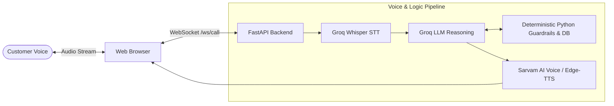

# Aura Skincare — AI Voice Support Agent (Aria)

A real-time, browser-based voice customer support agent built for **Aura Skincare**. You can open the web app, click **Start Call**, speak naturally, and get instant spoken replies with strict brand policy enforcement.

---

## Simple Architecture



### The Core Principle: "Never Trust the LLM"
* **The LLM handles the conversation:** Tone, politeness, empathy, and natural Indian English phrasing (*"Sir"*, *"Ma'am"*).
* **Deterministic Python code handles the rules:** The LLM is never allowed to calculate refund amounts, return windows, or decide if someone is allowed to see an order. All business logic and security checks live in regular Python code.

---

## Key Guardrails

1. **IDOR & Caller Privacy Protection:**
   The backend verifies order ownership in Python before giving data to the LLM. If Priya Sharma asks for Rahul Verma's order (`ORD-102`), the tool rejects it directly. The LLM never sees another customer's data.
2. **2-Step Confirmation for Cancellations:**
   Destructive actions cannot happen on an LLM's whim. Step 1 checks if the order is still `Processing` and flags a pending confirmation. Only after a second explicit verbal confirmation from the user does the tool cancel the order.
3. **Hard-Coded Business Policies:**
   - **Returns:** Strictly within 7 days of delivery and unopened.
   - **Shipping:** Free strictly above ₹499 (₹499 pays ₹50 shipping).
   - **Cash on Delivery (COD):** Allowed only up to ₹2,500.
   - The LLM does not calculate dates or math; Python code evaluates the rules and provides the answer.
4. **Out-of-Scope Deflection:**
   Non-brand requests (like booking flights or general trivia) are politely deflected back to Aura Skincare.

---

## Voice Experience Features

* **Real-Time Barge-In (Interruption):** If the customer speaks while Aria is speaking, playback cuts off instantly and the server stops the current turn.
* **10-Second Silence Detection:** After Aria finishes speaking, a 10-second timer starts. If the user is silent, Aria asks if they are still there (*"Take your time, Ma'am!"*). After another 10 seconds of silence, she gracefully ends the call.
* **Natural Indian Voice:** Uses Sarvam AI (`bulbul:v3`, voice *Shreya*) with automatic fallback to Edge-TTS (`en-IN-NeerjaNeural`).
* **Post-Call Structured Summary:** When the call ends, the backend generates an enum-validated JSON summary (`customer_intent`, `order_id`, `resolution_status`, `call_summary`) validated by Pydantic.

---

## Quickstart & Local Setup

### 1. Install Dependencies
```bash
pip install -r requirements.txt
```

### 2. Configure Environment
Copy `.env.example` to `.env` and add your API keys:
```env
GROQ_API_KEY=your_groq_api_key
SARVAM_API_KEY=your_sarvam_api_key
GROQ_MODEL=openai/gpt-oss-20b
PORT=8000
```
*(Note: If `SARVAM_API_KEY` is not provided, it automatically falls back to Edge-TTS.)*

### 3. Run the Application
```bash
uvicorn app.main:app --reload --port 8000
```
Open **http://localhost:8000** in your browser and click **Start Call**.

---

## Testing & Evaluation

* **Unit Tests (14 tests, offline, <1.5s):**
  ```bash
  pytest tests/ -v
  ```
* **Automated Scenarios Evaluation (14 test cases):**
  ```bash
  python scripts/run_scenarios.py
  ```
  Results are saved to `docs/eval_results.md`.

---

## Section 9: Evaluation Questions & Answers

### 1. Why did you choose this architecture and tech stack?
* **FastAPI + WebSockets:** Ultra-low latency full-duplex communication for streaming audio and control signals.
* **Groq Whisper + Groq LLM (`gpt-oss-20b`):** Sub-second response times necessary for realistic voice conversations on free-tier infrastructure.
* **Sarvam AI (with Edge-TTS fallback):** High-quality natural Indian English pronunciation with zero-downtime fallback.
* **Deterministic Python Layer:** Keeps business logic, calculations, and security checks completely separate from the probabilistic LLM.

### 2. What was the most difficult part and how did you solve it?
* **Audio Loopback & Echo:** Laptop speakers can feed back into the microphone, causing the agent to interrupt herself or loop endlessly.
* **Solution:** 
  1. Client-side audio feedback suppression in Web Audio API.
  2. Dynamic VAD thresholds (higher threshold while agent speaks).
  3. Whisper hallucination filters in STT to ignore low-confidence phantom audio.

### 3. If you had one more week, what would you improve?
1. **WebRTC:** Upgrade from WebSockets to WebRTC (via LiveKit or aiortc) for better packet loss handling and lower latency on mobile networks.
2. **Fuzzy Order ID Matching:** Use phonetic algorithms (Soundex / Levenshtein) so that order IDs transcribed with minor typos (e.g. "ward 101" instead of "ORD-101") are automatically resolved.
3. **Multi-Turn Slot Filling:** Add explicit state machine tracking for complex multi-step return/exchange requests.

### 4. What would need to change for 1,000 conversations a day?
1. **Database & Concurrency:** Move from mock memory dictionaries to PostgreSQL with row-level locks on cancellations to prevent race conditions.
2. **Caller Authentication:** Add caller ID lookup with SMS OTP verification before accessing private customer data.
3. **Horizontal Scaling:** Deploy FastAPI across container instances with Redis for shared session state and WebSocket handling.
4. **Observability:** Track latency metrics (Time-to-First-Audio), tool call accuracy, and error rates using Datadog or Langfuse.
